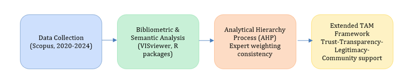
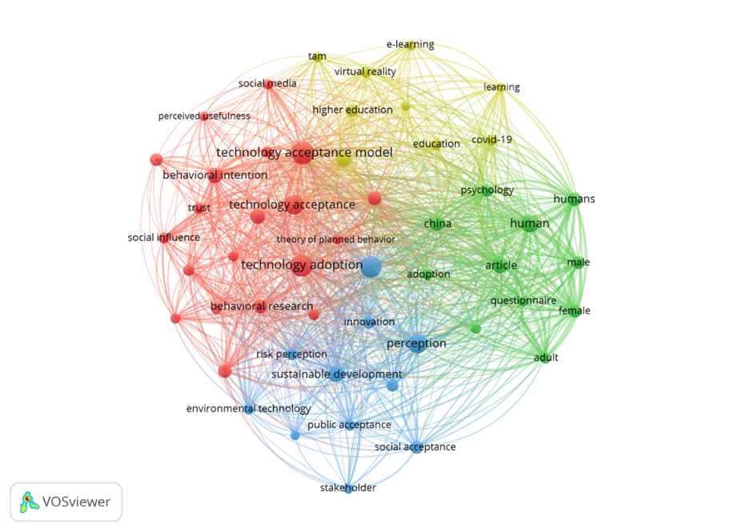
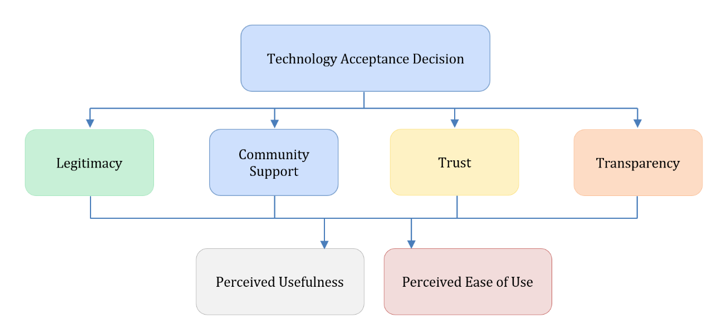

```{=html}
<div style="display:flex; flex-wrap:wrap; gap:6px; align-items:center; margin-bottom:10px;">

  <a href="https://doi.org/10.3389/fpsyg.2026.1723942" target="_blank" rel="noopener noreferrer">
    
  </a>

  <a href="https://doi.org/10.5281/zenodo.18415073" target="_blank" rel="noopener noreferrer">
    
  </a>

  <a href="https://opensource.org/licenses/MIT" target="_blank" rel="noopener">
    
  </a>

  <a href="https://www.r-project.org/" target="_blank" rel="noopener">
    
  </a>

  <a href="https://quarto.org/" target="_blank" rel="noopener">
    
  </a>

</div><br>
```

## 🧠 Overview

This repository hosts the **open and reproducible analytical materials** supporting the article submitted to Frontiers in Psychology (Environmental Psychology):

📄 **Article under review**\
**Behavioural and Institutional Drivers of Green Technology Adoption: An Extended Technology Acceptance Model Framework for Sustainability Transitions**

The project develops a **conceptual extension of the Technology Acceptance Model (TAM)** to examine how institutional trust, legitimacy, transparency, and community support shape citizens’ acceptance of green technologies.

Rather than providing empirical prediction models, the repository documents the **analytical logic, bibliometric mapping, and expert-based conceptual structuring** that underpin the theoretical contribution of the study.

## 🧩 Analytical and Conceptual Workflow

The analytical strategy follows a structured and transparent sequence:

**1. Literature corpus construction** Scopus-indexed journal articles (2021–2025) covering technology acceptance, sustainability, and behavioural policy.

**2. Bibliometric and semantic mapping** Keyword co-occurrence analysis using VOSviewer and R to identify thematic clusters.

**3. Structured expert elicitation** Conceptual organisation of behavioural and institutional dimensions using the Analytic Hierarchy Process (AHP).

**4. Conceptual integration** Development of an extended TAM framework adapted to governance-intensive sustainability contexts.

```{r fig2-index, echo=FALSE, fig.align='center', out.width='85%', fig.cap='Conceptual and analytical workflow underlying the extended TAM framework.'}


```

## 📊 Bibliometric Structure of the Field

The bibliometric analysis highlights the multidimensional nature of green technology adoption research, where behavioural constructs coexist with institutional and normative considerations.

The co-occurrence network reveals four main thematic clusters, encompassing behavioural adoption models, sustainability and environmental perception, psychosocial and institutional factors, and applied educational contexts.

```{r fig4-index, echo=FALSE, fig.align='center', out.width='85%', fig.cap='Keyword co-occurrence network derived from the 2021–2025 Scopus corpus.'}

```

These patterns provide the analytical basis for integrating institutional dimensions into the extended Technology Acceptance Model proposed in the article.

## 🧭 Conceptual Framework: Extended TAM

Building on the bibliometric evidence and expert-based structuring, the study advances an extended Technology Acceptance Model that situates classical cognitive beliefs within broader institutional contexts.

The framework retains perceived usefulness and perceived ease of use, while explicitly incorporating: trust, legitimacy, transparency, and community support as contextual conditions shaping adoption decisions.

```{r fig3-index, echo=FALSE, fig.align='center', out.width='85%', fig.cap='Extended Technology Acceptance Model integrating behavioural and institutional dimensions.'}

```

## 🗂️ Repository Structure

``` text
extended-tam-green-technology/
├─ docs/                 # Rendered project website (GitHub Pages)
├─ images/               # PNG figures used in the website and notebook
├─ figures_tiff/         # High-resolution TIFF figures for journal submission
├─ scripts/              # Reproducible R scripts (bibliometric and AHP analysis)
├─ references/
│  ├─ references.bib     # Complete BibTeX file (archived in Zenodo)
│  └─ README.md
├─ notebook.qmd          # Reproducible analytical notebook
├─ index.qmd
├─ _quarto.yml
└─ README.md
```

## ⚙️ Analytical tools

This project relies on bibliometric and conceptual analysis supported by:

-   **R** (bibliometric preprocessing and validation)
-   **VOSviewer** (keyword co-occurrence mapping)
-   **Quarto / GitHub Pages** (transparent documentation)

No predictive or operational models are implemented in this repository.

## 📚 Bibliographic Resources

The complete bibliography cited in the article\
*Behavioural and Institutional Drivers of Green Technology Adoption:\
An Extended Technology Acceptance Model Framework for Sustainability Transitions*\
is openly available in BibTeX format.

➡️ **Zenodo archive (DOI):** https://doi.org/10.5281/zenodo.18415073\
➡️ **File:** `references/references.bib`

This archive ensures long-term accessibility, citability, and reproducibility of the theoretical sources underpinning the conceptual framework.

## 🧭 Educational Use

This repository is intended for:

-   **researchers** working on technology acceptance, sustainability transitions, and behavioural public policy;
-   **postgraduate and doctoral** teaching in environmental psychology, governance, and interdisciplinary sustainability studies;
-   **methodological training** focused on bibliometric analysis and conceptually reproducible research.

The materials support conceptual replication and analytical transparency, rather than hands-on computational forecasting exercises.

## 📚 Citation

If you use this work, please cite the article:

> Mariscal, G., Cáceres-Tello, J., & Galán-Hernández, J. J. (2026). Behavioural and institutional drivers of green technology adoption: an extended technology acceptance model for sustainability transitions. *Frontiers in Psychology, 17*, 1723942. https://doi.org/10.3389/fpsyg.2026.1723942

If you use or refer to this repository, please cite:

> Mariscal, G., Cáceres-Tello, J., & Galán-Hernández, J. J. (2026). *Extended TAM for Green Technology Adoption: Reproducible materials*. Zenodo. https://doi.org/10.5281/zenodo.18415073

## ⚖️ License

This repository is released under the **MIT License**, permitting reuse, adaptation, and redistribution with attribution.

## 📬 Contact

Jesús Cáceres Tello

📧 jcaceres.academic\@gmail.com\
🌐 https://jcaceres-academic.github.io

⬅️ [Back to my main page](https://jcaceres-academic.github.io)

This repository supports open, transparent, and reproducible research in environmental data science and STEM education.
