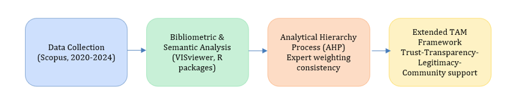
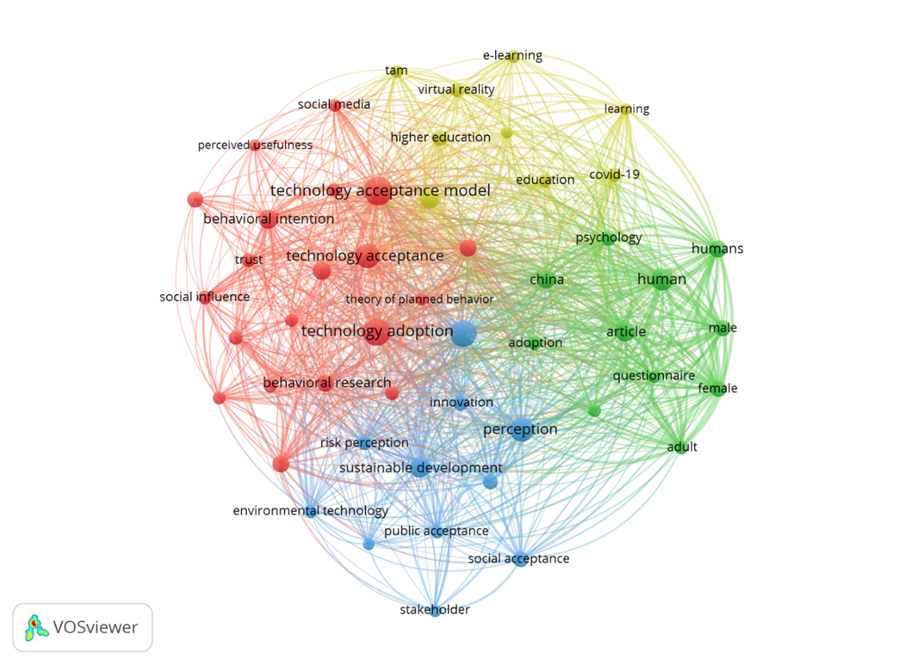
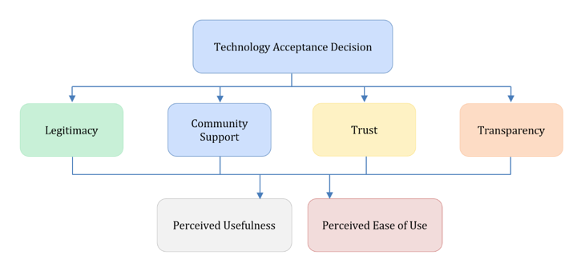

```{=html}
<div style="display:flex; flex-wrap:wrap; gap:6px; align-items:center; margin-bottom:10px;">

  <a href="https://doi.org/10.3389/fpsyg.2026.1723942" target="_blank" rel="noopener noreferrer">
    
  </a>

  <a href="https://doi.org/10.5281/zenodo.18415073" target="_blank" rel="noopener noreferrer">
    
  </a>

  <a href="https://opensource.org/licenses/MIT" target="_blank" rel="noopener">
    
  </a>

  <a href="https://www.r-project.org/" target="_blank" rel="noopener">
    
  </a>

  <a href="https://quarto.org/" target="_blank" rel="noopener">
    
  </a>

</div><br>
```

# 🧠 Purpose of this notebook

This notebook provides a reproducible and structured representation of the conceptual development and methodological reasoning underlying the associated publication:

Behavioural and Institutional Drivers of Green Technology Adoption: An Extended Technology Acceptance Model Framework for Sustainability Transitions (*Frontiers in Psychology*, 2026).

Rather than presenting empirical datasets or predictive models, this notebook focuses on structuring and documenting the analytical process underlying the study, illustrating:

-   how the literature corpus was constructed,
-   how bibliometric convergence was analysed,
-   how expert-based conceptual structuring was performed,
-   how behavioural and institutional dimensions were integrated into an extended TAM.

# 🔁 Analytical workflow

This section outlines the analytical logic that structures the development of the extended Technology Acceptance Model proposed in the article. Rather than representing a linear empirical pipeline, the workflow illustrates how bibliometric mapping, expert-based structuring, and conceptual integration were combined to support theory building in a transparent and reproducible manner. The diagram below summarises the main analytical stages and their interconnections

```{r fig-keywords2, echo=FALSE, fig.align='center', out.width='85%', fig.cap='Conceptual and analytical workflow underlying the extended TAM framework.'}

```

# 📊 Bibliometric structure of the field

Bibliometric analysis was used as an exploratory tool to examine how green technology adoption is currently framed in the academic literature. By analysing keyword co-occurrence patterns, this step allows the identification of dominant thematic clusters and conceptual proximities, providing an empirical basis for assessing whether behavioural and institutional constructs are already intertwined in existing research.

```{r fig-keywords3, echo=FALSE, fig.align='center', out.width='85%', fig.cap='Keyword co-occurrence network derived from the 2021–2025 Scopus corpus.'}

```

The observed clustering does not imply causal relationships, but it highlights areas of conceptual convergence that informed the subsequent integration of institutional dimensions into the extended TAM framework.

# 🧭 Conceptual framework: extended TAM

Building on the bibliometric patterns and the structured expert perspectives described in the article, this section presents the conceptual configuration of the extended Technology Acceptance Model. The framework is intended as an analytical lens rather than a statistically tested model, clarifying how individual cognitive beliefs are embedded within broader institutional conditions in sustainability-oriented adoption contexts.

```{r fig-keywords4, echo=FALSE, fig.align='center', out.width='85%', fig.cap='Extended Technology Acceptance Model integrating behavioural and institutional dimensions.'}

```

The framework situates perceived usefulness and perceived ease of use within institutional conditions shaped by trust, legitimacy, transparency, and community support.

# 🎓 Educational and academic use

Beyond supporting the specific article to which it is linked, this notebook has been designed as an educational resource for advanced training in sustainability, behavioural policy, and technology acceptance research. The emphasis is placed on methodological reasoning, conceptual synthesis, and transparency, rather than on software-specific instruction or predictive modelling.

This notebook can be used in:

-   doctoral seminars on technology acceptance and sustainability transitions,
-   courses on behavioural public policy and governance,
-   methodology workshops on bibliometric and conceptual synthesis.

The emphasis is on conceptual reproducibility, not numerical replication.

# 📚 Citation

If you use this work, please cite the article:

> Mariscal, G., Cáceres-Tello, J., & Galán-Hernández, J. J. (2026). Behavioural and institutional drivers of green technology adoption: an extended technology acceptance model for sustainability transitions. *Frontiers in Psychology, 17*, 1723942. https://doi.org/10.3389/fpsyg.2026.1723942

If you use or refer to this repository, please cite:

> Cáceres-Tello, J., & Galán-Hernández, J. J. (2026). *Extended TAM for Green Technology Adoption: Reproducible materials*. Zenodo. https://doi.org/10.5281/zenodo.18415073

# 📚 References

The complete bibliography used in this study is available in the repository as\
[`references/references.bib`](references/references.bib).

A citable and permanently archived version of this bibliography is available on Zenodo:\
[Zenodo archive (DOI: 10.5281/zenodo.18415073)](https://doi.org/10.5281/zenodo.18415073)
